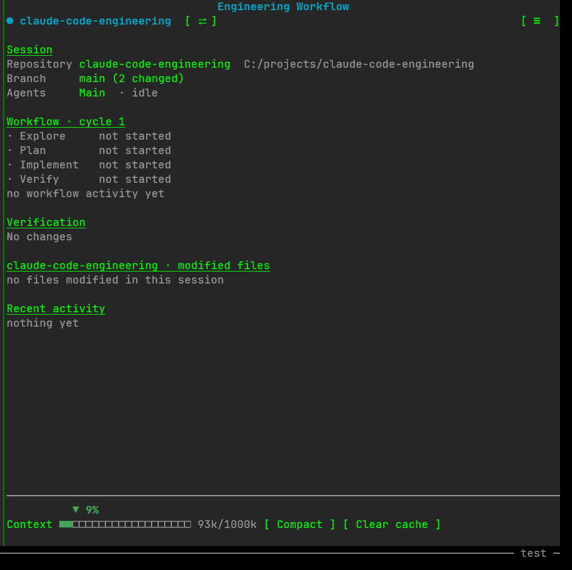

# claude-code-engineering

Modular agents, skills and mods for [Claude Code](https://docs.claude.com/en/docs/claude-code), designed around a disciplined **explore → plan → execute → verify** engineering loop.

Each agent has a single responsibility, a restricted tool set and an explicit handoff contract, so the parent session can delegate non-trivial work while keeping scope, risk and evidence under control.

## Contents

```
.
├── .claude-plugin/
│   └── marketplace.json
├── agents/
│   ├── codebase-explorer.md
│   ├── implementation-planner.md
│   ├── implementation-executor.md
│   └── implementation-verifier.md
├── plugins/
│   ├── context-optimizer/
│   └── engineering-workflow/
└── skills/
    └── handoff/
        └── SKILL.md
```

### Agents

| Agent | Role | Tools | Permission mode | Modifies code |
|-------|------|-------|-----------------|---------------|
| `codebase-explorer` | Maps entry points, execution flow, dependencies and risks before any change | Read, Grep, Glob, Bash | `plan` | No |
| `implementation-planner` | Turns exploration findings into the smallest safe, ordered implementation plan | Read, Grep, Glob, Bash | `plan` | No |
| `implementation-executor` | Implements the approved plan with minimal, localized changes and targeted validation | Read, Grep, Glob, Bash, Edit, Write | `acceptEdits` | Yes |
| `implementation-verifier` | Independently reviews the diff, runs relevant checks and issues a `PASS` / `CONDITIONAL PASS` / `FAIL` verdict | Read, Grep, Glob, Bash | default | No |

All agents run on `sonnet` with `memory: local` and a bounded `maxTurns`.

### Skills

| Skill | Description |
|-------|-------------|
| `handoff` | Compacts the current session into a dense handoff document (saved to the OS temp directory) so a fresh agent can resume the work. Accepts an optional argument describing the focus of the next session. |

### Plugins

| Plugin | Description |
|--------|-------------|
| [`context-optimizer`](plugins/context-optimizer/README.md) | A read-only audit of Claude Code instruction files (`CLAUDE.md`, `AGENTS.md`, `.claude/**/*.md`): oversized files and guidance repeated across files, reported with file and line evidence. Run it with `/context-optimizer:optimize`, or run `scripts/audit_context.py` on its own. It edits nothing and asks before any later change. |
| [`engineering-workflow`](plugins/engineering-workflow/README.md) | A read-only panel that follows the loop below in any Git repository: agents at work, current phase, modified files with their diffs, verification status, context window, open sessions and a link between two sessions. Opening sessions is automatic only with Windows Terminal; elsewhere the panel gives the command to run ([details](plugins/engineering-workflow/README.md#platform-support)). |



## Workflow

```
request
   │
   ▼
codebase-explorer ──► implementation-planner ──► (user approval) ──► implementation-executor ──► implementation-verifier
   findings               execution plan                                diff + handoff               verdict
                                                                              ▲                         │
                                                                              └──── executor feedback ◄─┘ (on FAIL)
```

1. **Explore** – understand the relevant subsystem, separating facts, inferences and hypotheses.
2. **Plan** – define goal, scope, risks and ordered steps with validation criteria.
3. **Execute** – implement only the approved scope; stop and report if the plan is invalid or riskier than expected.
4. **Verify** – check acceptance criteria, scope drift and regressions without modifying code.

Trivial, localized changes can skip the loop entirely.

## Installation

Copy (or symlink) the folders into your Claude Code configuration.

**User-level** (available in every project):

```bash
cp agents/*.md ~/.claude/agents/
cp -r skills/* ~/.claude/skills/
```

**Project-level** (shared with the team via the repository):

```bash
mkdir -p .claude/agents .claude/skills
cp agents/*.md .claude/agents/
cp -r skills/* .claude/skills/
```

Restart Claude Code (or run `/agents`) to load the new agents.

**Plugins**, from this repository's marketplace:

```bash
claude plugin marketplace add <owner>/claude-code-engineering
claude plugin install engineering-workflow@claude-code-engineering
claude plugin install context-optimizer@claude-code-engineering
```

## Usage

Agents are invoked automatically when their description matches the task, or explicitly:

```
> Use codebase-explorer to trace how authentication tokens are refreshed
> Use implementation-planner to plan the change based on those findings
```

Invoke the skill with:

```
/handoff continue the refactor of the payment module
```

Audit a project's instruction files for duplication and context overhead:

```
/context-optimizer:optimize
```

## Customization

- **High-risk areas**: the planner, executor and verifier share generic high-risk categories (shared modules, public interfaces, state boundaries, integration points, persisted data, security-sensitive code, concurrency, configuration) and honor areas flagged as high-risk in the plan or project documentation. Add your codebase's own to the lists.
- **Testing conventions**: `implementation-verifier` discovers test, lint and build commands from the plan, project instructions (`CLAUDE.md`, `CONTRIBUTING.md`), build manifests and CI configuration.
- **Model and limits**: adjust `model`, `maxTurns` and `permissionMode` in each agent's frontmatter.

## Roadmap

- Reusable workflows
- More terminal backends for the sessions menu (`tmux`)

## License

[MIT](LICENSE) © 2026 Placido Di Blasi
